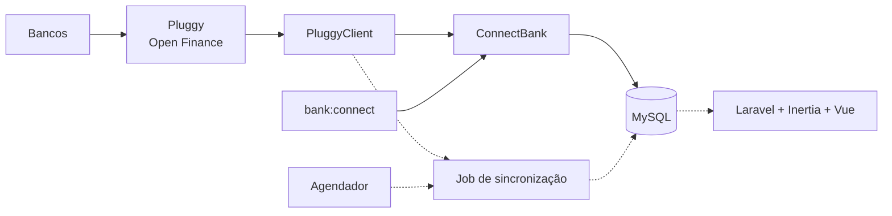
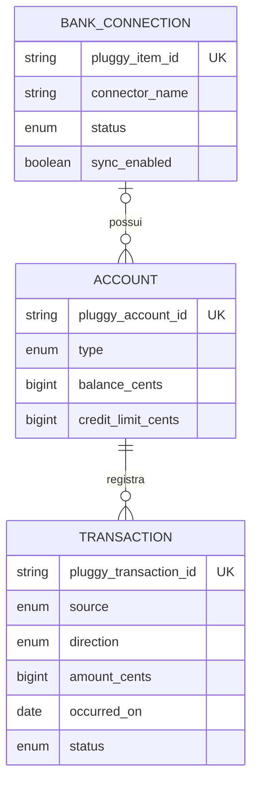

# BuggCoin

[](https://github.com/MerloFd/buggcoin_laravel/actions/workflows/tests.yml)


Aplicação web de finanças pessoais que integra contas bancárias via Open Finance para responder três perguntas: **quanto gastei no mês, quanto ainda posso gastar e quanto já está comprometido nos próximos meses.**

> **Em desenvolvimento.** A fundação, o modelo de dados e o client de Open Finance estão prontos. A sincronização e as telas financeiras são as próximas etapas.

## Destaques técnicos

| Desafio                                | Solução                                                                                        | Código                                                                           |
| -------------------------------------- | ---------------------------------------------------------------------------------------------- | -------------------------------------------------------------------------------- |
| Valores sem erro de arredondamento     | Dinheiro em centavos inteiros, com a direção em coluna própria                                 | [`Transaction`](app/Models/Transaction.php)                                      |
| Importar sem duplicar o mesmo registro | Índice único no identificador externo da transação                                             | [migration](database/migrations/2026_11_17_000003_create_transactions_table.php) |
| Consumir uma API externa com segurança | Credenciais só no servidor, chave de acesso criptografada em cache e erros sem dados sensíveis | [`PluggyClient`](app/Services/Pluggy/PluggyClient.php)                           |
| Paginação confiável                    | Cursor validado, com proteção contra ciclos e respostas malformadas                            | [`PluggyClientTest`](tests/Feature/Pluggy/PluggyClientTest.php)                  |
| Preservar o histórico financeiro       | Excluir uma conexão nunca apaga contas ou transações                                           | [`AccountTest`](tests/Feature/Models/AccountTest.php)                            |
| Proteger o acesso                      | Usuário único, cadastro desativado, 2FA e passkeys                                             | [`config/fortify.php`](config/fortify.php)                                       |

## Arquitetura

Linhas contínuas já estão implementadas; as tracejadas são as próximas etapas.



### Modelo de dados



## Stack

- **Back-end:** PHP 8.4, Laravel 13, Fortify e MySQL 8.4
- **Front-end:** Vue 3, TypeScript, Inertia 3, Tailwind CSS 4 e shadcn-vue
- **Testes e qualidade:** Pest 5, Larastan nível 7, Pint, vue-tsc e GitHub Actions
- **Ambiente:** Docker Compose para o banco de desenvolvimento

## Qualidade

Cada push na `main` passa no CI por testes, análise estática, checagem de tipos, lint e formatação. Nos testes, qualquer requisição HTTP não simulada falha, então a suíte nunca acessa a API bancária real.

```bash
composer ci:check
```

## Como executar

**Requisitos:** PHP 8.4 com `pdo_mysql` e `pdo_sqlite`, Composer, Node 22+ e Docker.

```bash
git clone https://github.com/MerloFd/buggcoin_laravel.git
cd buggcoin_laravel
cp .env.example .env
```

Preencha `DB_PASSWORD`, `OWNER_NAME`, `OWNER_EMAIL` e `OWNER_PASSWORD` no `.env`. Depois:

```bash
docker compose up -d --wait
composer setup
php artisan db:seed
composer dev
```

As credenciais do Pluggy são opcionais e só são usadas para conectar um banco.

## Roadmap

- [x] Autenticação com 2FA e passkeys
- [x] Design system com temas claro e escuro
- [x] Modelo de conexões, contas e transações
- [x] Client de Open Finance e cadastro de conexões
- [ ] Sincronização agendada e manual
- [ ] Telas de transações e bancos
- [ ] Lançamentos manuais e conciliação assistida
- [ ] Painel mensal, faturas e parcelas
- [ ] PWA e deploy

As especificações e as decisões de cada etapa ficam em [`openspec/`](openspec/changes/bank-sync-and-list).
